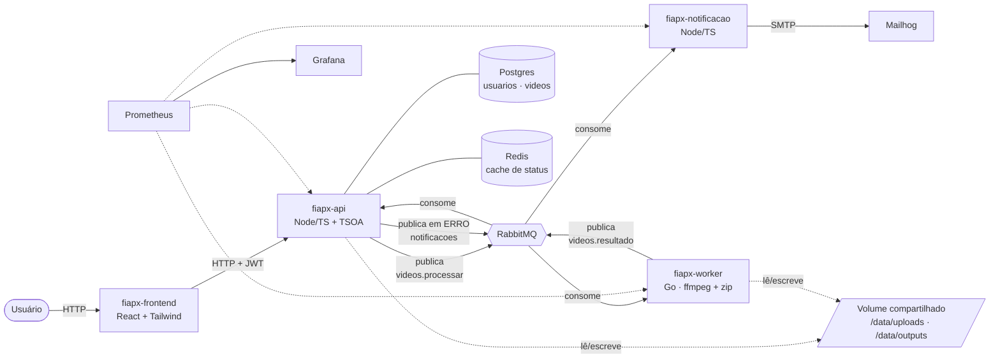
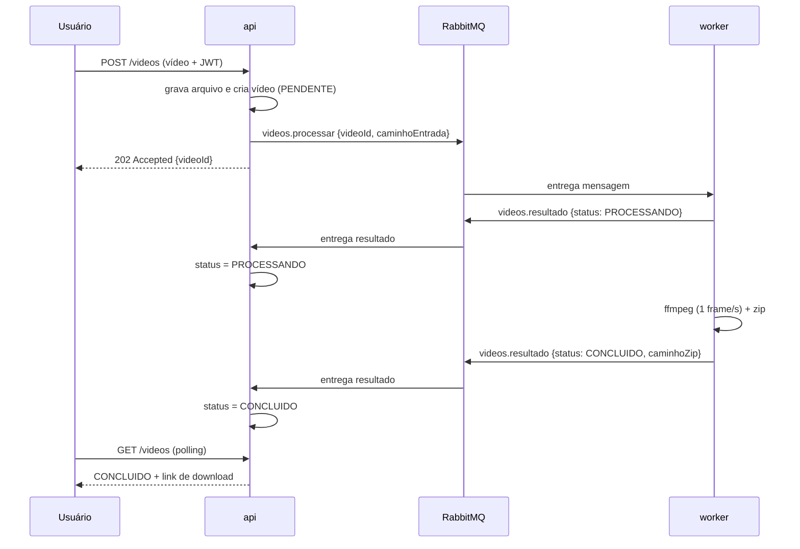
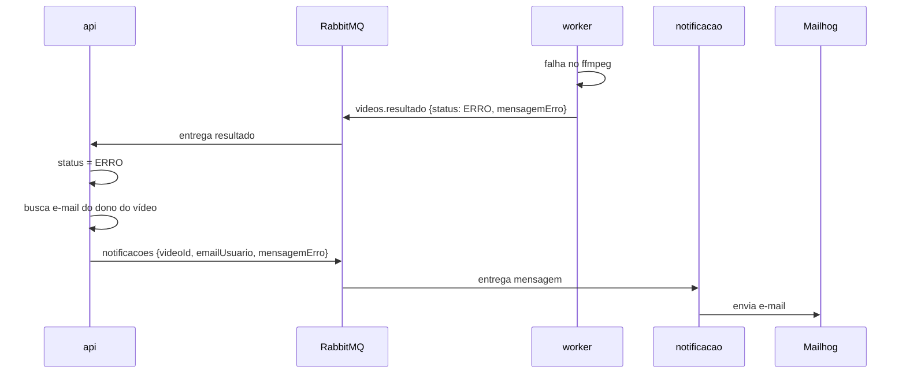

# Arquitetura

## O problema

A versão anterior do sistema era um monólito: uma única aplicação recebia o vídeo, extraía os
frames e devolvia o `.zip` **na mesma requisição**. Isso trazia três limitações sérias:

- O usuário ficava esperando o processamento inteiro (que pode levar minutos).
- Em um pico de envios, a aplicação tentava processar tudo ao mesmo tempo e derrubava requisições.
- Não havia usuário, histórico nem aviso de falha.

A nova arquitetura separa **receber o pedido** de **executar o trabalho**, usando mensageria.

## Visão geral

## Fluxo de sucesso

## Fluxo de erro

## Serviços

| Serviço | Responsabilidade | Stack | Banco |
|---|---|---|---|
| `fiapx-api` | Autenticação, envio de vídeo, catálogo/status, download. Publica o pedido de processamento, consome o resultado e dispara a notificação em caso de erro. | Node + TypeScript (TSOA/Swagger) | Postgres + Redis |
| `fiapx-worker` | Extrai os frames (ffmpeg, 1/s) e monta o pacote `.zip`. Reporta o resultado por evento. | Go | — (stateless) |
| `fiapx-notificacao` | Envia e-mail ao usuário quando um processamento falha. | Node + TypeScript | — (stateless) |
| `fiapx-frontend` | Interface web: login, envio, acompanhamento de status e download. | React + Tailwind | — |
| `fiapx-infra` | Orquestração (Docker Compose), monitoramento e documentação. | Docker Compose | — |

## Filas e contratos

Os serviços **não conversam por HTTP entre si** — apenas por mensagens JSON no RabbitMQ. Cada
serviço define os próprios tipos; os contratos são estes:

| Fila | Sentido | Mensagem |
|---|---|---|
| `videos.processar` | api → worker | `{ "videoId": string, "caminhoEntrada": string }` |
| `videos.resultado` | worker → api | `{ "videoId": string, "status": "PROCESSANDO" \| "CONCLUIDO" \| "ERRO", "caminhoZip"?: string, "mensagemErro"?: string }` |
| `notificacoes` | api → notificacao | `{ "videoId": string, "emailUsuario": string, "mensagemErro": string }` |

## Decisões estruturantes

### Mensageria em vez de HTTP síncrono
A api responde `202 Accepted` assim que enfileira o pedido — o usuário não espera o processamento.
A fila absorve picos (nada se perde) e permite vários workers consumindo em paralelo. Se um worker
cair no meio, a mensagem continua na fila. Ver [ADR 0003](adr/0003-mensageria-vs-http.md).

### Database-per-service
Nenhum serviço compartilha banco. Apenas a **api** tem banco (Postgres), porque só ela é dona de
usuários e do catálogo de vídeos. O worker é **stateless**: não acessa banco nem sabe quem é o
usuário — ele apenas reporta o resultado, e a api o traduz em mudança de status.

### SAGA por coreografia
O fluxo é uma sequência de eventos em que cada serviço reage ao evento anterior, **sem um
orquestrador central**. O caminho de erro (marcar `ERRO` + notificar o usuário) é o passo
compensatório da saga. Ver [ADR 0005](adr/0005-saga-coreografia.md).

### Clean Architecture
Cada serviço é organizado em `dominio` → `aplicacao` → `adaptadores`. Ver [ADR 0004](adr/0004-clean-architecture.md).

## Escalabilidade

- Serviços **stateless** e configurados por variáveis de ambiente.
- O processamento escala horizontalmente aumentando o número de workers, que competem pela mesma
  fila: `docker compose up --scale worker=3`.
- O sistema é **k8s-ready**: migrar para Kubernetes significa escrever os manifests
  (`Deployment`, `Service`, `HPA`, probes) e trocar o volume compartilhado por object storage.
  Ver [Limitações conhecidas](limitacoes-conhecidas.md).

## Armazenamento

Vídeos enviados e pacotes gerados ficam em um **volume Docker compartilhado**, montado na api e no
worker:

- `/data/uploads` — vídeos recebidos (escritos pela api, lidos pelo worker).
- `/data/outputs` — pacotes `.zip` (escritos pelo worker, servidos pela api).

## Monitoramento

Cada serviço expõe `/health` (saúde) e `/metrics` (formato Prometheus). O Prometheus coleta as
métricas e o Grafana exibe o dashboard (vídeos por status, duração do processamento, mensagens
consumidas).

## Como rodar

Ver o [README](../README.md) — os repositórios são clonados como irmãos e a stack sobe de dentro
do `fiapx-infra`.
