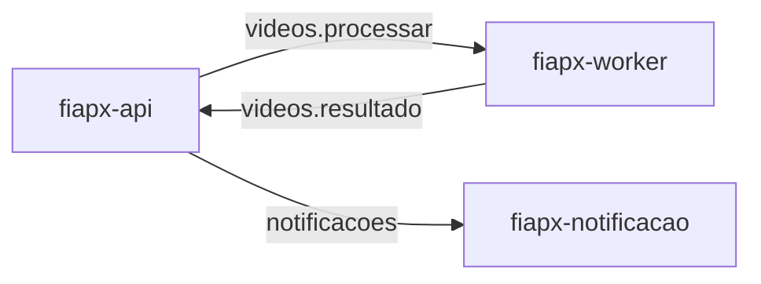
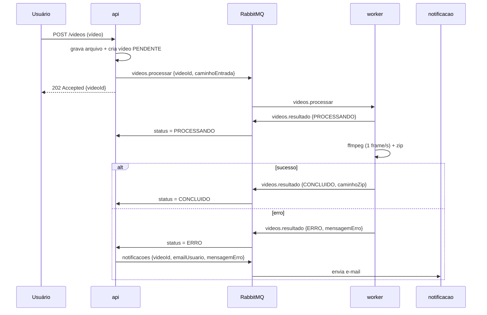

# Contratos de fila

Este documento é a **fonte da verdade** das mensagens trocadas entre os serviços do FIAP X.
Os serviços **não conversam por HTTP entre si** — apenas por mensagens JSON no **RabbitMQ**,
numa [SAGA por coreografia](adr/0005-saga-coreografia.md). Cada serviço define os próprios
tipos internos; o que precisa ser combinado é o formato das mensagens abaixo.

## Convenções

- **Transporte:** RabbitMQ. As filas são **duráveis** e as mensagens são persistentes, para
  sobreviverem a uma reinicialização do broker.
- **Formato:** JSON em UTF-8. Os nomes dos campos são exatamente os desta página.
- **Confirmação:** o consumidor usa **ack manual** — só confirma a mensagem depois de
  processá-la. Se cair no meio, a mensagem volta para a fila.
- **Entrega:** *at-least-once*. A mesma mensagem pode chegar mais de uma vez; o tratamento de
  idempotência é uma [limitação conhecida](limitacoes-conhecidas.md).

## Visão geral



## Filas

### `videos.processar` — api → worker

Publicada pela **api** quando um vídeo é enviado e gravado como `PENDENTE`. Pede ao worker que
extraia os frames e monte o pacote.

| Campo | Tipo | Descrição |
|---|---|---|
| `videoId` | string | Identificador do vídeo (dono do fluxo). |
| `caminhoEntrada` | string | Caminho do vídeo no volume compartilhado (`/data/uploads/...`). |

```json
{ "videoId": "a1b2c3", "caminhoEntrada": "/data/uploads/a1b2c3.mp4" }
```

### `videos.resultado` — worker → api

Publicada pelo **worker** para reportar o andamento e o desfecho do processamento. A api traduz
cada mensagem em uma mudança de status do vídeo.

| Campo | Tipo | Obrigatório | Descrição |
|---|---|---|---|
| `videoId` | string | sim | Identificador do vídeo. |
| `status` | `"PROCESSANDO"` \| `"CONCLUIDO"` \| `"ERRO"` | sim | Novo status do vídeo. |
| `caminhoZip` | string | quando `CONCLUIDO` | Caminho do `.zip` no volume (`/data/outputs/...`). |
| `mensagemErro` | string | quando `ERRO` | Motivo da falha, legível para o usuário. |

```json
{ "videoId": "a1b2c3", "status": "CONCLUIDO", "caminhoZip": "/data/outputs/a1b2c3.zip" }
```

```json
{ "videoId": "a1b2c3", "status": "ERRO", "mensagemErro": "Falha no ffmpeg ao extrair frames" }
```

### `notificacoes` — api → notificacao

Publicada pela **api** quando um vídeo termina em `ERRO`. É o passo compensatório da saga: avisar
o usuário. O serviço de notificação envia o e-mail.

| Campo | Tipo | Descrição |
|---|---|---|
| `videoId` | string | Identificador do vídeo que falhou. |
| `emailUsuario` | string | E-mail do dono do vídeo. |
| `mensagemErro` | string | Motivo da falha a ser comunicado. |

```json
{ "videoId": "a1b2c3", "emailUsuario": "fulano@email.com", "mensagemErro": "Falha no ffmpeg ao extrair frames" }
```

## Fluxo completo



## Armazenamento compartilhado

Os caminhos (`caminhoEntrada`, `caminhoZip`) referenciam um **volume compartilhado** montado na
api e no worker:

- `/data/uploads` — vídeos recebidos (a api escreve, o worker lê).
- `/data/outputs` — pacotes `.zip` (o worker escreve, a api serve no download).
